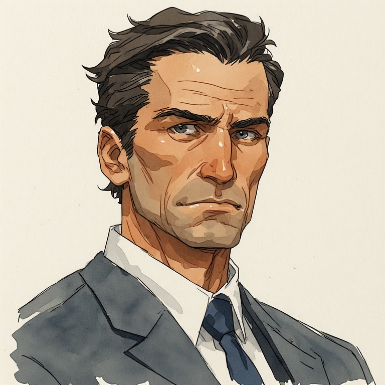

# Cornelius

<figure style="display:flex; gap:1rem; align-items:flex-start;flex-wrap:wrap">
   <figure style="margin:0; ">
    
    <figcaption style="font-size:0.9em; opacity:0.7;">
      Cornelius
    </figcaption>
  </figure>
</figure>

**Status:** Bevorzugter Name; Details weiterhin teilweise offen.

Mächtigster Waffenindustrieller der Welt und Vater der schwerkranken **Noémi**. Er gab den einzigartigen, vom Pip-Stone angetriebenen Shell-Prototyp **zur Rettung seiner Tochter** in Auftrag, nicht primär als Waffe. Elenas Vater entwendete bzw. zweckentfremdete die Shell, um Elena zu retten.

## Persönlichkeit und Verhandlungsstil

Cornelius verkörpert äußerlich den stereotypischen skrupellosen Industriegiganten: mächtig, kontrolliert, geschäftsorientiert, kühl und weithin verhasst. Tatsächlich ist er ein außergewöhnlich fähiger, aufrichtiger Verhandlungspartner. Er sucht **Win-win-Lösungen** und argumentiert wirtschaftlich und rational, nicht durch emotionale Manipulation. Er ist durchaus hart und nachdrücklich, aber nicht hinterlistig um der Manipulation willen.

Viele erleben diese Sachlichkeit als Herzlosigkeit. Sympathie, moralische Anerkennung und sein öffentliches Image sind für ihn nachrangig. Er kann mit Hass auf seine Person umgehen, ohne sich rehabilitieren zu müssen. Wirtschaftlichkeit bedeutet für ihn nicht kurzfristige Gewinnmaximierung, sondern langfristige Stabilität, Wohlstand und tragfähige Ergebnisse.

Er kann Fehler und bessere Argumente anerkennen. Wäre rational schlüssig nachweisbar, dass ein anderer seine Macht zum besseren Ergebnis einsetzen könnte, wäre er prinzipiell bereit, sie abzugeben. **Das ist eine Charaktereigenschaft, kein geplanter Handlungsbogen.**

## Weltbild und verdeckter Einfluss

Cornelius denkt in globalen, langfristigen Zusammenhängen: Wohlstand für den **gesamten Planeten**, Lebensqualität, Ressourcen, Umwelt und das langfristige Gedeihen der Menschheit. Themen wie Überbevölkerung und ökologische Belastungen betrachtet er als komplexe Systemprobleme, nicht als Rechtfertigung, Menschen auszusortieren oder massenhaft zu töten. Vernünftige, nachhaltige Lösungen stehen im Vordergrund.

Er legt wenig Wert auf Moral als eigenständiges Entscheidungskriterium. Er ist bereit, eine auf individueller Ebene moralisch verwerfliche Entscheidung zu treffen, wenn deren langfristige Folgen nach seinen belastbaren Berechnungen erheblich besser sind. Unnötige Grausamkeit ist ihm fremd; vermeidbares Leid wäre auch aus seiner Sicht sinnlos. Er versteht, dass seine Entscheidungen anmaßend und eigenmächtig sind, und akzeptiert diese Kritik.

Als weltweit größter Waffenproduzent beliefert er unter Umständen **beide Seiten eines Krieges**. Insgeheim kann er dadurch Kriegsverläufe beeinflussen oder steuern. Als mögliche technische Umsetzung stehen unbemerkte Fernsteuerungsfunktionen in Waffensystemen, Satelliteninfrastruktur und eine KI zur subtilen Orchestrierung im Raum; beispielsweise könnten Geschosse einer Kriegspartei gezielt nicht detonieren. Die technischen Einzelheiten sind noch nicht festgelegt.

Er nutzt diesen Einfluss nach seinen Vorstellungen **zum Wohl der Menschheit**, um Konflikte und deren Folgen zu begrenzen. Als Setzung der Spielwelt ist er dabei bemerkenswert erfolgreich: Ohne seinen Einfluss wäre die Welt voraussichtlich deutlich schlechter dran. Das rechtfertigt seine eigenmächtige Kontrolle nicht automatisch, macht ihn aber auch nicht zu einem bloß selbstgerechten Schurken.

Er entscheidet letztlich allein, weil er breit angelegte Abstimmungen und interessengeleitete Kompromisse für eine Verwässerung der sachlich besten Lösung hält. Sein Anspruch auf diese Entscheidungsmacht ist hochgradig anmaßend, beruht aber nicht auf sadistischer Lust, Menschen zu beherrschen.

## Noémi und der Konflikt um die Shell

**Sein unmittelbares, vorrangiges Ziel in Elenas Geschichte ist die Rückgewinnung der Shell. Noémis Leben hängt davon ab.**

Cornelius erkennt grundsätzlich an, dass auch Elena eine eigene Existenz und eigene Interessen hat. Sein bevorzugter Weg ist deshalb eine möglichst sinnvolle Lösung **für alle Beteiligten** – etwa eine tragfähige Alternative, die Noémi rettet, ohne Elena zu opfern, sofern sich eine solche realisieren lässt.

Er verhandelt ernsthaft, bietet gegebenenfalls Ressourcen und Alternativen an und legt seine Interessen offen. Seine Bereitschaft zum Ausgleich darf aber nicht mit Nachgiebigkeit verwechselt werden: Er wird die Shell **nachdrücklich** zurückfordern. Scheitert eine Einigung, kann er auch Gewalt einsetzen und diesen Schritt im Voraus sachlich ankündigen. Er braucht dafür weder Hass auf Elena noch einen plötzlichen Persönlichkeitswechsel.

Das ist bereits der wesentliche Interessenkonflikt; Cornelius braucht keinen zusätzlichen philosophischen Konflikt oder einen eigenen großen Charakterbogen.

## Rolle im Spiel und Spielerperspektive

**Elena bleibt Spielerfigur, nicht moralische Kommentatorin.** Wie Cornelius und seine Entscheidungen zu bewerten sind, soll vorwiegend der Spieler selbst entscheiden. Die Geschichte soll seine Weltsicht nicht durch Elenas vorgefertigte Gedanken erklären oder bewerten.

Frühere Spielerentscheidungen können ein implizites **Denkprofil** prägen, das spätere Dialogoptionen beeinflusst bzw. zusätzliche Argumentationsmöglichkeiten eröffnet. Das Profil soll möglichst nicht in eine simple Gut/Böse-Skala münden und den Spieler nicht auf eine einmal eingenommene Haltung festnageln. Die konkrete Ausgestaltung ist noch offen.

Cornelius kann abhängig von Elenas Entscheidungen als Verhandlungspartner, Verbündeter oder Gegner auftreten, ohne seine grundlegende Persönlichkeit zu wechseln. Die größere Welt und seine verdeckten Aktivitäten bilden Hintergrund und Charaktertiefe; **die Handlung handelt von Elena, nicht von Cornelius**. Wie viel der Spieler über seine geheimen Eingriffe erfährt, ist offen.

## Umfeld und Familie

Er verbringt die meiste Zeit in seinem Firmenhochhaus, dem **Obelisken**. Denkbar ist, dass die gesamte Familie in geschützten oberen Stockwerken wohnt, damit Noémi trotz ihrer Isolation in seiner Nähe sein kann.

Noémi weiß zunächst nichts vom Shell-Projekt. Seine Geheimhaltung entspringt auch der Ungewissheit, ob das Vorhaben überhaupt funktionieren wird. Die Erkenntnis, wie weit er zu ihrer Rettung gehen würde, könnte später einen Konflikt zwischen Vater und Tochter auslösen.

Seine Frau ist eine hochrangige Wissenschaftlerin; ihre mögliche radikalere Reaktion auf den Verlust von Noémis Rettungschance ist in anderen Dokumenten als **offene Option** festgehalten.

## Rivalen

Die Leiter der konkurrierenden Organisationen könnten einander persönlich kennen, teils mit gemeinsamer beruflicher Vergangenheit, zerbrochenen Kooperationen und Rivalitäten. Nicht alle Konflikte sind rein strategisch: alte Kränkungen und persönliche Machtkämpfe können die Jagd auf die Shell beeinflussen. Konkrete Beziehungen sind noch offen.

## Prompts

### Portrait
```text
**Character:** Cornelius

A distinguished, authoritative man in his early-to-mid 50s, with a rugged, angular, masculine face and a commanding yet restrained presence.

**Facial structure:** Elongated rectangular face, broad forehead with pronounced horizontal wrinkles, strong angular jawline, prominent cheekbones, slightly hollow cheeks, broad square chin.

**Eyes:** Deep-set, narrow gray-blue eyes, framed by thick, dark, nearly straight eyebrows. Pronounced vertical frown lines between the eyebrows. His gaze is intense, analytical, and focused.

**Nose:** Strong, straight, prominent nose with a broad bridge.

**Mouth:** Relatively narrow mouth, thin-to-medium lips, slightly downturned corners, usually held in a firm, neutral expression.

**Hair:** Short, thick, dark brown hair, almost black, subtly graying at the temples. Classic professional haircut with shorter sides and longer, naturally textured hair combed backward and slightly sideways. Slightly receding temples.

**Skin:** Light-to-medium complexion with warm, slightly tanned undertones. Natural skin texture, visible age lines around the forehead and eyes. Clean-shaven with subtle natural beard shadow.

**Physique:** Tall, approximately 185 cm, broad shoulders, solid athletic build without exaggerated musculature.

**Clothing:** Tailored charcoal-gray business suit, crisp white dress shirt, dark navy tie. Conservative, elegant, understated professional appearance.

**Overall impression:** Mature, intelligent, determined, disciplined, naturally authoritative. His facial features communicate strength and experience rather than conventional youthful beauty.

**Important:** Maintain consistent facial proportions, eye shape, nose structure, jawline, hairline, and distinctive forehead wrinkles across all images, regardless of expression, clothing, pose, or artistic style.


painterly watercolor illustration, semi-realistic proportions, realistic anatomy,
soft brush strokes, hand-painted look,
simplified forms, clean silhouettes,
limited detail, low visual noise,
clear lighting, strong value contrast,
muted color palette.
concept art watercolor on textured paper. 
```