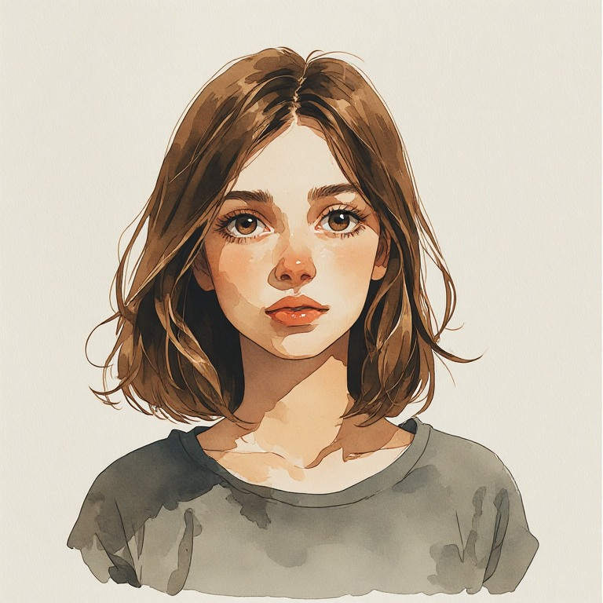
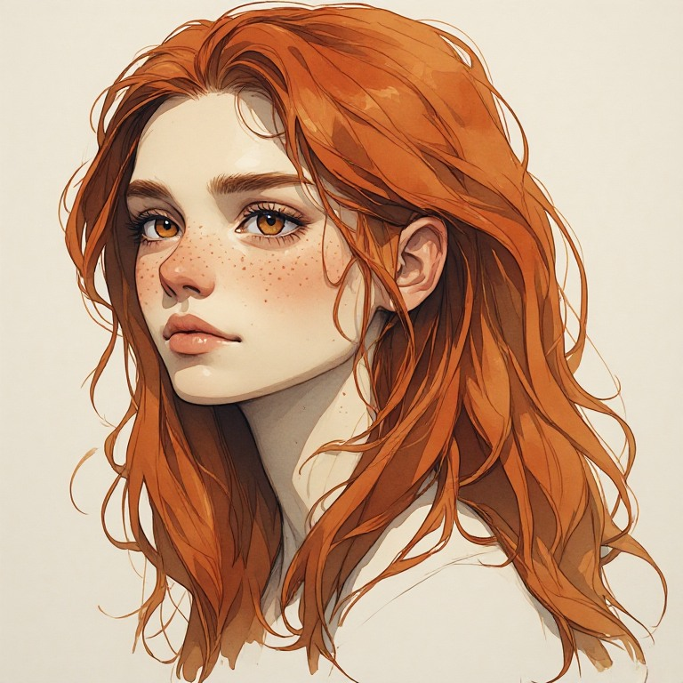

# Elena

<figure style="display:flex; gap:1rem; align-items:flex-start;flex-wrap:wrap">
   <figure style="margin:0; ">
    
    <figcaption style="font-size:0.9em; opacity:0.7;">
      Elena, 16 Jahre
    </figcaption>
  </figure>
   <figure style="margin:0; ">
    
    <figcaption style="font-size:0.9em; opacity:0.7;">
      Elena (Noémis Gesicht)
    </figcaption>
  </figure>
</figure>

> Figurenkonzept / Arbeitsstand für *Elena: Prime*. Der genaue Verlauf der Beziehungen und Szenen ist noch offen.

## Ausgangssituation

Elena ist die jugendliche Protagonistin. Nach einem Unfall, bei dem sie sich für Tabetha vor ein Auto wirft, fällt sie ins Koma. Ihr Vater, ein leitender Ingenieur, rettet sie, indem er einen einzigartigen kybernetischen Körper entwendet, der ursprünglich für die kranke Tochter eines mächtigen Industriellen bestimmt war. Elena erwacht in einem fremden Aussehen und versteht zunächst nicht, was geschehen ist. Ihr durch den Pip-Stone angetriebener Körper ist dem menschlichen weit überlegen, doch sie bleibt ein Mädchen mit eigener Geschichte und eigenen Entscheidungen.

## Identität und Bewusstsein

Eine grundlegende Frage ist, ob in der Shell noch ein organisches Gehirn steckt oder Elenas Bewusstsein vollständig elektronisch existiert. **Elenas Haltung dazu bleibt dem Spieler überlassen.** Sie kann sich über Erinnerungen, Bewusstsein und Verhalten definieren, aber ebenso unter der Ungewissheit leiden, ob noch etwas organisch Menschliches von ihr übrig ist. Äußere Einflüsse, insbesondere Lenas mögliche Ablehnung, können ihre Selbstwahrnehmung verändern.

In einer möglichen Szene fragt ihre Mutter, ob sie überhaupt noch ein Gehirn besitzt. **Tabetha** hält diese biologische Frage für unerheblich und verteidigt Elena: Für Tabetha bleibt Elena durch ihr Verhalten, ihre Erinnerungen und ihr Bewusstsein dieselbe Person. Elena selbst kann zustimmen, zweifeln oder anders reagieren – abhängig von den Spielerentscheidungen.

## Beziehung zu Tabetha

Elena und Tabetha verbindet seit ihrer Kindheit eine tiefe Nähe und eine unbeschwerte, verspielte gemeinsame Vergangenheit. Ihre Beziehung kann sich zu einer **aufrichtigen Liebesbeziehung** entwickeln; Zeitpunkt und Verlauf bleiben offen. Der Unfall trennt die beiden zunächst: Elena verliert ihren bisherigen Körper, Tabetha kämpft mit Trauer und Schuldgefühlen. Ihre spätere Begegnung birgt großes emotionales Potenzial, gerade weil Elenas Äußeres nicht mehr das vertraute ist.

Tabetha ist nicht nur Beschützerin und Elena nicht nur Schutzbedürftige. Beide haben eigene Sichtweisen. Tabethas Gewissheit kann Elenas eigenen Zweifeln gegenüberstehen oder sie in einer ähnlichen Haltung bestärken.

## Inspiration: *Kiss* von Tanya Chalkin

Das Schwarzweißfoto *Kiss* von Tanya Chalkin ist ein wesentliches emotionales und visuelles Motiv für die Beziehung. Die beiden Models heißen **Elena und Tabetha**. Nach der recherchierten Entstehungsgeschichte kannten sie sich vor dem Shooting nicht; das schmälert die Wirkung des Motivs nicht. Die Fotografie inspiriert die fiktive Bindung, stellt aber **keine Biografie** der Spielfiguren dar.

Lange war auch **Tabetha** als Name der Protagonistin angedacht. In der neueren Entwicklung erscheint **Elena** dafür passender.

## Offene Fragen

- Wie entwickelt sich die Freundschaft zur Liebesbeziehung?
- Wann und wie erkennt Tabetha Elena nach dem Erwachen in der Shell?
- Wie reagiert Elenas Familie auf ihre veränderte Existenz?
- Wie viel organische Substanz enthält die Shell tatsächlich – und wird diese Frage überhaupt beantwortet?

## Verwandte Figuren

- [Tabetha](tabetha.md)
- [Lena](lena.md)

## Prompts

### Portrait, 16 Jahre
```text
Portrait of a 16yo girl, front-facing or slightly turned, with a soft oval face and gentle, 
harmonious proportions. 
Large, expressive eyes with deep irises and subtle light reflections, an alert yet kind gaze. 
natural understated lips, a small straight nose.
Short brown hair, light brown to very dark brown, smooth and silky, shoulder-length, 
loosely falling with soft natural movement, delicate strands framing the face.
Expression combining innocence, determination, and quiet inner strength. Calm presence, subtle emotional depth. 

painterly watercolor illustration, semi-realistic proportions, realistic anatomy,
soft brush strokes, hand-painted look,
simplified forms, clean silhouettes,
limited detail, low visual noise,
clear lighting, strong value contrast,
muted color palette.
concept art watercolor on textured paper. 
```
### Portrait
```text
Noémi, a young vital adult woman approximately 16 years old

Her appearance is delicate, fragile and unmistakably human

**Distinctive facial features:**

A small, softly oval face with a gently tapered chin, delicate cheekbones and a narrow, rounded jawline.

Large almond-shaped amber-colored eyes with slightly heavy upper eyelids, giving her a naturally melancholic, contemplative expression.

A small, delicate nose with a narrow, straight bridge and softly rounded tip.

Naturally full, softly defined lips with a slightly fuller lower lip and a subtle Cupid's bow.

A faint scattering of reddish freckles across her nose and upper cheeks.

**Eyes:**
Amber eyes. Natural black pupils, clearly defined iris boundaries, normal white sclera.

No makeup, no lipstick.

**Hair:**

Extremely long, thick, voluminous red hair, falling well below her waist.

Soft natural waves, loose individual strands, slightly untamed texture and a subtle center part.

**Expression and demeanor:**

Calm, introspective, intelligent and quietly self-possessed.

Her expression conveys a subtle, thoughtful melancholy without overt suffering.

Preserve realistic human anatomy, natural facial proportions and subtle biological imperfections.


painterly watercolor illustration, semi-realistic proportions, realistic anatomy,
soft brush strokes, hand-painted look,
simplified forms, clean silhouettes,
limited detail, low visual noise,
clear lighting, strong value contrast,
muted color palette.
concept art watercolor on textured paper. 
```
