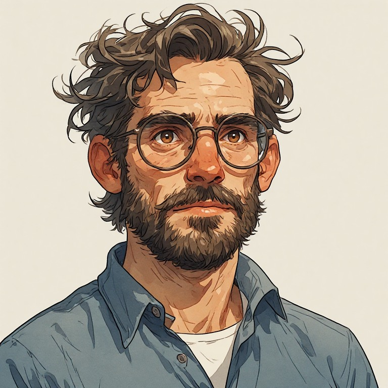

# Elenas Vater – Chefingenieur

<figure style="display:flex; gap:1rem; align-items:flex-start;flex-wrap:wrap">
   <figure style="margin:0; ">
    
    <figcaption style="font-size:0.9em; opacity:0.7;">
      Isaac
    </figcaption>
  </figure>
</figure>

**Status:** Name offen.

Chefingenieur des geheimen Cyborgprojekts im Auftrag von Cornelius. Seine Tochter Elena liegt nach einem Autounfall Wochen oder Monate im Koma; ihr Körper oder Bewusstsein droht zu versagen. Um sie zu retten, transferiert er ihr Bewusstsein **unerlaubt** in den für Noémi vorgesehenen Körper.

Elena weiß von seiner streng geheimen Arbeit und dem Transfer nichts. Er hinterlässt ihr Anweisungen und einen Fluchtplan. Beim Erwachen Elenas wird er vor der Labortür von Security festgenommen; ein Schuss ist zu hören, dessen Ursache noch ungeklärt ist.

Seine Tat rettet womöglich Elena, nimmt aber Noémi ihre einzige bekannte Rettungschance. Noémis Mutter könnte später grausame Vergeltung an ihm üben (noch offene Idee).

## Zeitdruck und Transfer
Isaac ist ein hochkompetenter Chefingenieur, aber Amandas automatisierte Bewusstseinssynchronisation ist nicht sein Fachgebiet. Er kann sie initialisieren, ohne ihre gesamte Logik zu beherrschen. Elenas Zustand verschlechtert sich zunehmend. Isaac sieht dadurch seine letzte Chance schwinden, seine Tochter zu retten, und wird zum sofortigen Handeln gedrängt. Die medizinische Ursache muss nicht näher bestimmt oder erklärt werden.

Isaac muss den Raum nach dem Start verlassen, **bevor er weiß, ob der Transfer erfolgreich war**. Was vor der Tür geschieht, kann je nach Durchlauf variieren. Seine grundlegende Motivation bleibt immer die Rettung Elenas.

## Prompts
### Portrait
```text
**Character:** Isaac

A brilliant, introspective male engineer in his late 40s, with a slightly unconventional intellectual appearance, expressive facial features, and a thoughtful, somewhat weary demeanor.

**Facial structure:** Elongated oval face with subtly angular features, relatively high forehead, prominent cheekbones, slightly hollow cheeks, narrow-to-medium jawline, and a moderately narrow chin partially concealed by facial hair.

**Eyes:** Deep-set, expressive dark brown to hazel eyes, framed by thick, slightly irregular dark eyebrows. Subtle wrinkles around the eyes, noticeable under-eye shadows, and a naturally thoughtful gaze.

**Nose:** Prominent, relatively long nose with a strong bridge and a slightly rounded tip.

**Mouth:** Medium-width mouth, relatively thin lips, naturally relaxed expression with subtly downturned corners.

**Facial hair:** Short, dense, slightly uneven full beard and mustache, medium brown with scattered gray hairs. Natural texture, neither perfectly groomed nor excessively unkempt.

**Hair:** Thick, medium-length, naturally wavy and slightly unruly medium-brown hair with ash-brown and gray strands, particularly around the temples. Voluminous, irregular hairstyle with loose strands falling toward the forehead. Slightly receding hairline. No precise parting or slicked-back styling.

**Glasses:** Large, nearly round, slightly oval eyeglasses with thin dark bronze metal frames, a narrow metal bridge, and relatively large lenses. Classic, understated, slightly old-fashioned design.

**Skin:** Light complexion with warm undertones, subtle reddish coloration around the nose and cheeks, natural skin texture, visible age lines, and mild signs of fatigue.

**Physique:** Approximately 178 cm tall, slim-to-average build, relatively narrow shoulders, natural proportions without pronounced musculature.

**Posture:** Slightly forward-leaning, relaxed but occasionally restless. Capable of extremely precise, controlled movements when concentrating on technical work.

**Clothing:** Casual, practical, slightly wrinkled blue-gray button-down shirt with an open collar and a white undershirt. Muted colors, functional clothing, no unnecessary accessories.

**Overall impression:** Highly intelligent, introspective, emotionally complex, somewhat unconventional, and quietly determined. A man who appears more concerned with solving difficult problems than maintaining a polished public image.

**Important:** Maintain consistent facial proportions, distinctive nose shape, expressive eyes, large round metal-framed glasses, irregular wavy hairstyle, beard shape, and slightly asymmetrical facial features across all images, regardless of expression, clothing, pose, or artistic style.

Avoid exaggerated nerd stereotypes, cartoonish awkwardness, excessively wild hair, or an overly disheveled appearance.

painterly watercolor illustration, semi-realistic proportions, realistic anatomy,
soft brush strokes, hand-painted look,
simplified forms, clean silhouettes,
limited detail, low visual noise,
clear lighting, strong value contrast,
muted color palette.
concept art watercolor on textured paper. 
```