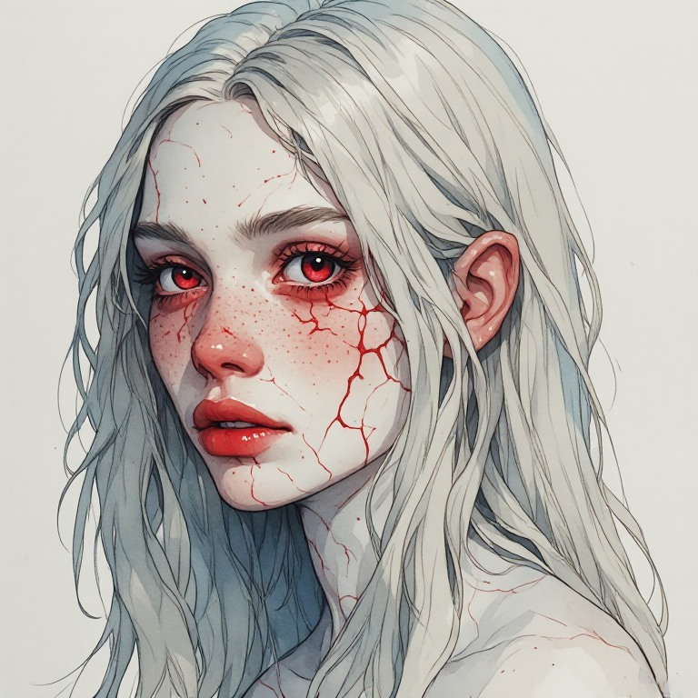
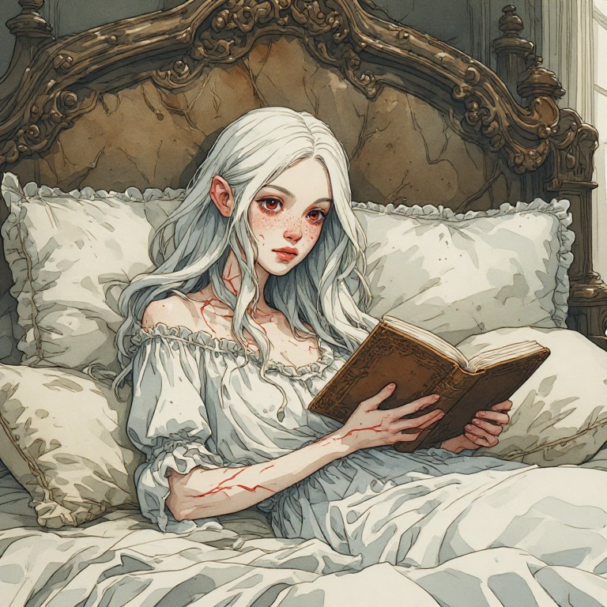

# Noémi

<figure style="display:flex; gap:1rem; align-items:flex-start;flex-wrap:wrap">
   <figure style="margin:0; ">
    
    <figcaption style="font-size:0.9em; opacity:0.7;">
      Noémi
    </figcaption>
  </figure>
   <figure style="margin:0; ">
    
    <figcaption style="font-size:0.9em; opacity:0.7;">
      Noémi
    </figcaption>
  </figure>
</figure>

**Status:** Figurenkonzept, Alter als Bildreferenz ca. 16; genaue Chronologie offen.

Tochter von Cornelius und einer hochrangigen Wissenschaftlerin. Sie leidet an einer seltenen, fortschreitenden Erkrankung, die ihren Körper auf zellulärer Ebene buchstäblich auflöst. Pigmente gehen früh verloren; Haut wird außergewöhnlich dünn, mechanisch verletzlich und regeneriert schlecht. Noémi ist ein Mensch, kein übernatürliches Wesen.

## Erscheinung
- Sehr blasse, nahezu pigmentlose Haut, langes silbrig-weißes Haar, Sommersprossen, blutrote Lippen und rote Iris (mit normaler Pupille). Die rote Färbung ist als fiktive Folge von Pigmentverlust und durchscheinendem Gefäßgewebe gedacht.
- Durch die extrem dünne Haut sind Adern sichtbar: feine bläuliche Venen und rötliche Gefäße mit weichen, unterschiedlich intensiven Konturen **unter** der Haut. Keine dekorativen roten Risse, kein geometrisches Netz.
- Kleine ovale Gesichtsform, weiche Wangenknochen, schmale Nase, mandelförmige Augen; menschliche, abgerundete Ohren.
- Visuelle Zielrichtung: malerisches Aquarell / handgemalte Konzeptillustration, nicht Fotorealismus und nicht Elfen-Fantasy.
- **Bilddateien und Perchance-Prompts werden später manuell ergänzt.** Die bisherigen Bildversuche liefern bereits brauchbare Treffer, aber noch gelegentlich spitze Ohren und zu scharfe oder zu schwache Adern.

## Alltag und Persönlichkeit
Noémi ist wegen ihrer extrem empfindlichen Haut weitgehend isoliert. Sie lebt überwiegend im Bett in einem luxuriösen, verletzungssicheren Umfeld: weiche Stoffe, Teppiche, Becher statt zerbrechlicher Gläser und weitere Vorkehrungen. Sie liest außerordentlich viel. Die Isolation hat sie für ihr Alter ungewöhnlich reserviert, reflektiert und belesen gemacht; praktische soziale Erfahrung fehlt ihr teilweise. Sie hat ihre Erkrankung weitgehend akzeptiert, ohne deshalb keinen Lebenswillen zu besitzen. Sie ist neugierig und urteilt nicht vorschnell.

Die Familie könnte vollständig in den oberen Stockwerken des Obelisken leben, damit ihr arbeitssüchtiger Vater zugleich in ihrer Nähe und in seiner Firmenzentrale sein kann.

## Elena und die Shell
Cornelius ließ die einzigartige, dem gesunden Erscheinungsbild Noémis nachempfundene Shell ursprünglich für sie bauen; sie wird vom einzigartigen Pip-Stone angetrieben. Elenas Vater transferierte jedoch Elena hinein. Noémi weiß zunächst **nichts** vom Shell-Projekt und auch nicht, wie weit Cornelius für ihre Rettung gehen würde. Sie kennt ihren Vater und kann Zusammenhänge erschließen. Beim Anblick der Shell empfindet sie vor allem Verwunderung und Neugier, keinen Groll gegen Elena.

**Mögliche frühe Foreshadowing-Szene:** Wählt Elena die Flucht über die Außenfassade zum Dach des Obelisken, schaut Noémi ihr aus einem Fenster der obersten Etagen nach; für den Spieler nur schwer zu bemerken.

Eine spätere erste persönliche Begegnung könnte durch eine wütende Elena entstehen, die in Noémis Zimmer stürmt und dort unerwartet mit ihrer Verletzlichkeit konfrontiert wird. Noémi ist für einen Austausch offen; keine feindselige Grundbeziehung festgelegt.

## Mögliche Entwicklungen (nicht festgelegt)
- Cornelius und Noémi geraten in Konflikt, sobald sie erfährt, welche Opfer eine Rückgabe der Shell erfordern könnte.
- Digitalisierung ihres Bewusstseins als körperlose Präsenz im Familienanwesen oder im Obelisken; dabei bleiben Identitätskontinuität und der Verlust körperlicher Erfahrung offene Fragen.
- Spätere alternative künstliche Körper könnten Noémi aufnehmen; unter Umständen kontrolliert sie sogar mehrere bis sehr viele Körper. Dies ist eine mögliche, vom Weltverlauf abhängige Entwicklung, kein feststehendes Ende.
- Der Kontrast zu Elena: körperlich zerfallende, belesene Noémi gegenüber körperlich überlegener, aber identitär verunsicherter Elena.

## Material
<!-- Hier später Noémis Bilder, Prompt-Versionen und Referenzen einfügen. -->

### Prompts

#### Portrait
```text
Noémi, a young adult woman approximately 16 years old, suffering from an extremely rare progressive cellular degenerative disease.

Her appearance is delicate, fragile and unmistakably human, with subtle but unsettling physiological abnormalities caused by her condition.

**Distinctive facial features:**

A small, softly oval face with a gently tapered chin, delicate cheekbones and a narrow, rounded jawline.

Large almond-shaped eyes with slightly heavy upper eyelids, giving her a naturally melancholic, contemplative expression.

A small, delicate nose with a narrow, straight bridge and softly rounded tip.

Naturally full, softly defined lips with a slightly fuller lower lip and a subtle Cupid's bow.

A faint scattering of reddish freckles across her nose and upper cheeks.

**Eyes and lips:**

Her disease has destroyed most of the natural pigmentation in her body.

Her irises are a striking, translucent blood-red, revealing delicate radial iris structures and subtle variations of crimson and ruby.

Natural black pupils, clearly defined iris boundaries, normal white sclera.

Her eyes are biological and human, not glowing or supernatural.

Her lips have a naturally intense blood-red coloration caused by the underlying vascular tissue showing through exceptionally thin, depigmented skin.

No makeup, no lipstick.

**Hair:**

Extremely long, thick, voluminous silvery-white hair, falling well below her waist.

Soft natural waves, loose individual strands, slightly untamed texture and a subtle center part.

**Skin and vascular anatomy:**

Extremely thin, fragile, almost translucent human skin,
very pale ivory complexion with subtle natural variations,
delicate bluish undertones beneath the skin,
faint reddish discoloration around the temples, eyelids and neck,
subtle blue veins barely visible beneath the skin,
soft diffuse vascular shadows,
natural human skin translucency,
subtle variations in skin thickness,
realistic subsurface scattering,
delicate biological fragility,
natural skin texture

**Expression and demeanor:**

Calm, introspective, intelligent and quietly self-possessed.

She appears comfortable with her own unusual physiology, despite its profound physical limitations.

Her expression conveys a subtle, thoughtful melancholy without overt suffering.

**Important visual constraints:**

No exaggerated red veins.
No thick vascular lines.
No symmetrical branching patterns.
No red cracks or fissures.
No painted-on blood vessels.
No glowing eyes.
No fantasy vampire features.
No porcelain doll appearance.
No open wounds or bleeding.
No excessive vascular coverage.
No artificial skin patterns.

Preserve realistic human anatomy, natural facial proportions and subtle biological imperfections.

painterly watercolor illustration, semi-realistic proportions, realistic anatomy,
soft brush strokes, hand-painted look,
simplified forms, clean silhouettes,
limited detail, low visual noise,
clear lighting, strong value contrast,
muted color palette.
concept art watercolor on textured paper. 
```
#### im Bett
```text
Traditional watercolor character illustration, delicate hand-painted character concept art, grounded human anatomy on textured watercolor paper.

Soft, expressive brushwork, visible watercolor washes, subtle pigment granulation, delicate pencil outlines, simplified shapes, restrained details, muted colors, gentle tonal transitions.

Noémi, a 16-year-old human girl suffering from a rare degenerative disease.

A small oval face, delicate cheekbones, softly rounded chin,
small straight nose, natural human ears with rounded tips,
blood-red lips and light freckles across her nose and cheeks.

Large almond-shaped eyes with naturally red irises,
visible iris texture and black pupils.

Very long, thick, naturally wavy white hair,
parted in the middle, falling over her shoulders.
Her ears are mostly hidden beneath her hair.

Her appearance is entirely human, with realistic facial anatomy.

Visible blue veins beneath the skin of her wrists and forearms.
Fine reddish blood vessels showing through the skin
of her neck, collarbones and temples.

The blood vessels are clearly recognizable,
with irregular natural shapes and varying thickness.

Her skin is extremely thin and almost transparent,
making the underlying veins visible.

The vessels appear beneath the surface,
their colors slightly softened by the translucent tissue.

Very pale, depigmented skin with a delicate,
medically fragile appearance.


Noémi is reclining comfortably in an enormous antique bed, surrounded by soft ivory pillows, embroidered blankets and luxurious fabrics.

She wears a loose, delicate ivory nightgown with subtle lace decorations.

An old leather-bound book rests open in her hands. She is quietly absorbed in reading.

Behind her rises an elaborate, dark wooden headboard with antique baroque carvings.

Soft, diffused daylight enters through tall windows, illuminating her pale hair and delicate features.

The atmosphere is peaceful, intimate and slightly melancholic.

Elegant composition, medium shot, natural relaxed posture.

Muted ivory, pale blue-gray, antique gold and dusty rose color palette, with subtle crimson accents in her eyes and lips.

Painterly watercolor illustration, traditional hand-painted appearance, soft brush strokes, delicate outlines, simplified forms, low visual noise, watercolor pigment on textured paper.
```