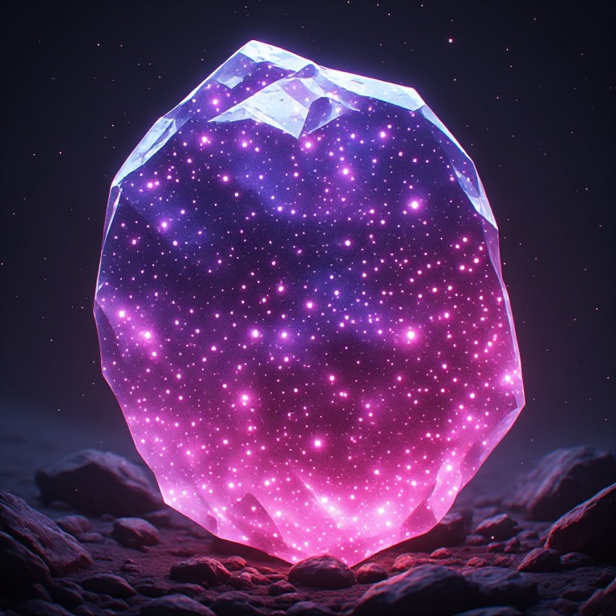

# der Pip-Stone

Der **Pip-Stone** ist ein mystisches, etwa faustgroßes Artefakt, das als wiederkehrendes Element verschiedene Spielwelten und Geschichten miteinander verbindet.

Die Bezeichnung Pip-Stone dient dabei lediglich als projektübergreifender Name. Je nach Welt, Zeitalter und Kultur ist das Artefakt unter anderen Namen bekannt.

Der Stein umgibt sich mit einer geheimnisvollen Aura, deren wahre Natur kein Sterblicher vollständig zu erfassen vermag. Seine Macht scheint grenzenlos, doch entzieht sie sich dem Willen seiner vermeintlichen Besitzer. Vielmehr scheint der Stein selbst zu entscheiden, wann, wie und in welcher Form sich seine Kräfte offenbaren.

Manche glauben, in seinem Inneren liege das gesamte Universum.

Und sie haben recht.

## Ursprung
Der **Pip-Stone** wurde von [Pitcher Pip](batterBarney/characters/pitcher-pip.md) erschaffen, nachdem dieser seine göttliche Natur erkannt und angenommen hatte.

Erst nachdem er seine sterbliche Existenz hinter sich gelassen hat, erkennt er sein wahres Wesen und erschafft schließlich den Pip-Stone.

Da die Zeit weder zwingend linear noch ausschließlich vorwärts verläuft, besitzt diese Schöpfung keinen eindeutig bestimmbaren Ursprung. Der Stein kann bereits existieren, bevor Pip ihn aus seiner eigenen Perspektive erschaffen hat.

Der Pip-Stone enthält das gesamte Universum und bildet zugleich ein wesentliches Instrument, mit dem Pip besondere Ereignisse innerhalb seiner Schöpfung orchestriert.

## Auftreten
### Batter Barney
Pitcher Pip erschafft den Pip-Stone im ultimativen Abspann des Spiels und setzt damit die ewige Zeitschleife um Barney in Gang.

Da die Zeit keiner festen linearen Abfolge unterliegt, existiert der Stein bereits während der eigentlichen Spielhandlung.

Mit seiner Hilfe kann [Gwendolyn](./batterBarney/characters/gwendolyn.md) nach [Sovic](./batterBarney/locations/sovic.md) zurückkehren und [Barney](./batterBarney/characters/batter-barney.md) endgültig verlassen. Für Barney, der bereits zahlreiche Enttäuschungen durch sie erlitten hat, ist dies der Tropfen, der das Fass zum Überlaufen bringt.

Er wird zum maskierten Widersacher seiner selbst und initiiert jene Invasion der Erde, mit der die Spielgeschichte beginnt.

Pip, der inzwischen seine Göttlichkeit erkannt hat, hält diese Zeitschleife aufrecht. Sie ist Teil von Barneys Leben und Bestimmung.

### Elena#1
Der Pip-Stone dient als Energiequelle und gewissermaßen als Herz von [Elenas](./elenaN1/characters/elena.md) [Shell](./elenaN1/items/shell.md).

Er versorgt sowohl deren Kern als auch den jeweils angeschlossenen Körper mit unbegrenzter Energie.

Über einen Zeitraum von mehr als 200 Jahren hält er Elenas Gehirn und ihre Shell am Leben.

Durch diese außergewöhnlich lange und unmittelbare Nähe zum Stein erfährt Elena mehr über dessen wahre Natur als jeder andere Sterbliche.

In ihren letzten Jahren befindet sie sich in einer Schlafphase, während der sie durch den Stein die Weisheit des Universums erlangt.

Diese Erkenntnis ermöglicht es ihr schließlich, den Pip-Stone freiwillig an Yvaine weiterzugeben und ihren eigenen Tod anzunehmen.

### Yvaine
Durch die Entdeckung des Pip-Stones und die Verbindung seiner Kräfte mit fortgeschrittener Technologie erlangt die Menschheit die Fähigkeit zu Raumsprüngen.

[Yvaine](./yvaine/characters/yvaine.md) ist die leitende Forscherin dieser Entwicklung.

Der Stein dient als Energiequelle ihres Shuttles und ermöglicht, sobald dieses an das Mutterschiff angedockt ist, Reisen über gewaltige Entfernungen hinweg.

Mit seiner Hilfe erforscht Yvaine unzählige Zivilisationen und Welten.

Obwohl sie den Pip-Stone über einen längeren Zeitraum besitzt wie Elena, entwickelt sie niemals eine so starke Verbindung zu ihm wie diese.

Ihr letzter Flug endet in einem Riss durch Zeit und Raum, der sie ins alte China verschlägt.

### 6 Blades
Der Pip-Stone bildet einen wesentlichen Bestandteil der **Universumsklinge** (Arbeitstitel).

Diese Waffe ist für den finalen Kampf von entscheidender Bedeutung.

### Angel´s Guardian
Ein Engel verwendet den Pip-Stone, um eine ultimative Waffe zu erschaffen.

Mit ihr beendet er den Krieg zwischen Engeln und Dämonen endgültig, indem er beide Seiten vollständig vernichtet.

Engel wie Dämonen.

### Mistress of Time and Space
Das Schloss der [Mistress of Time and Space](./mistressOTAS/README.md) befindet sich im Inneren des Pip-Stones.

Dieser Zusammenhang wird innerhalb des Spiels niemals ausdrücklich enthüllt.

Stattdessen deutet das charakteristische Farbmuster der Außenwelt auf die Verbindung zum Stein hin.

## Übergreifende Bedeutung

Der Pip-Stone verbindet unterschiedliche Geschichten, Welten und Zeitalter, ohne dass diese unmittelbar aufeinander aufbauen müssen.

Seine Erscheinungsformen und Funktionen unterscheiden sich erheblich. Er kann Energiequelle, Werkzeug, Waffe oder sogar der Schauplatz einer ganzen Geschichte sein.

Seine eigentliche Natur bleibt den meisten Figuren verborgen.

Auch für den Spieler müssen die Zusammenhänge nicht offensichtlich sein. Vielmehr können wiederkehrende Details, Ereignisse und Hinweise erst im Rückblick ihre vollständige Bedeutung entfalten.

Der Pip-Stone ist damit nicht nur ein wiederkehrendes Artefakt, sondern Ausdruck einer Wirklichkeit, in der Schöpfung, Zeit und Kausalität keiner festen Ordnung unterliegen.